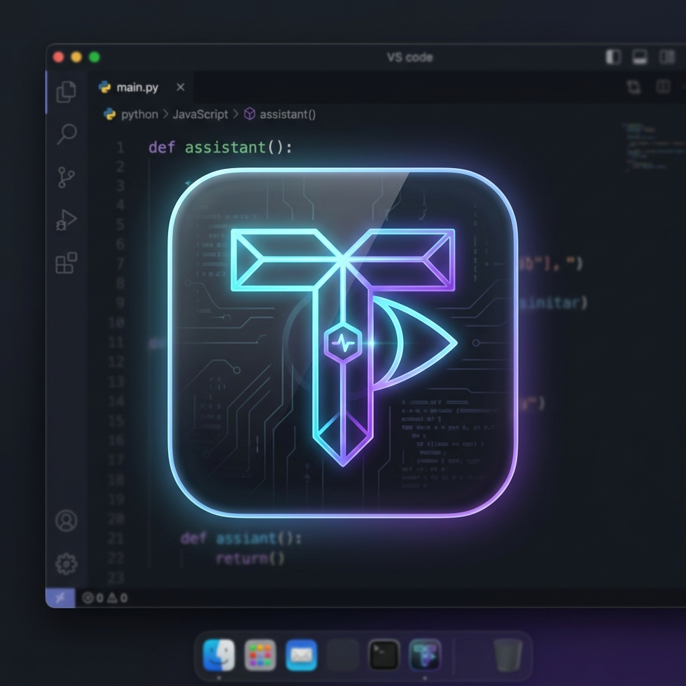
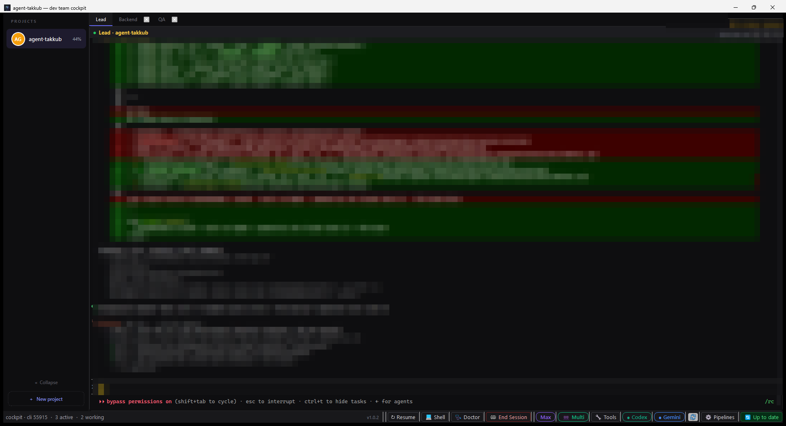
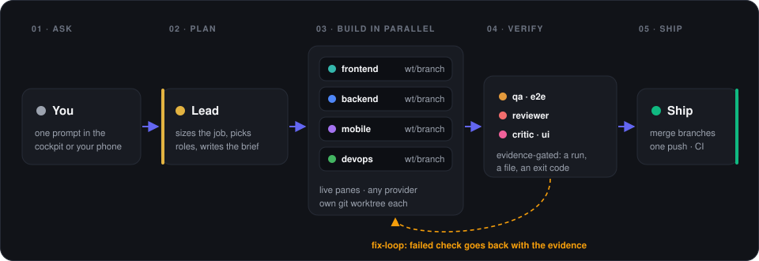
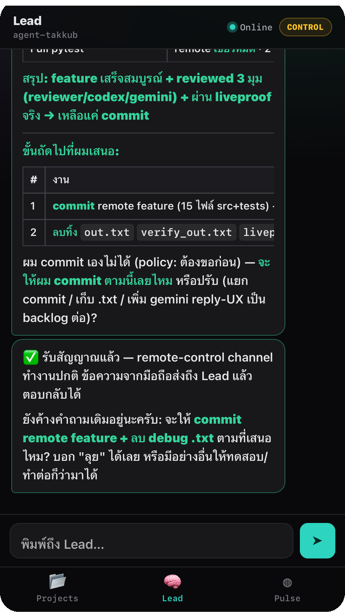

<div align="center">



# agent-takkub

**Your AI dev team in one desktop cockpit.**<br>
You talk to one *Lead* agent. It plans the work, runs specialist agents side by side, checks their results and brings back a finished change.

[](https://www.npmjs.com/package/agent-takkub)
[](https://github.com/takkub/agent-takkub/actions/workflows/ci.yml)
[](https://github.com/takkub/agent-takkub/blob/main/LICENSE)
[](https://github.com/takkub/agent-takkub#-get-started)
[](https://github.com/takkub/agent-takkub#-five-providers-one-team)

```bash
npm install -g agent-takkub
```

<sub>Runs on your machine with the agent CLIs you already use · no extra server</sub>

</div>

<p align="center">
  
</p>

## ✨ What it does

| | |
| :-- | :-- |
| 🧠 **One Lead, a whole team** | You give the Lead a task. It decides which roles the job needs (frontend, backend, mobile, devops, qa, reviewer, critic and more) and briefs each one. |
| 🔀 **Parallel work** | Each teammate is a live agent pane. Frontend and backend build at the same time, and each one works on its own git branch and worktree. |
| ✅ **Checks with evidence** | QA, reviewer and critic go last, against the real build. A report that cites no test run, file or exit code is flagged for the Lead. |
| 🔁 **Fix loop** | A failed check goes back to the teammate with the evidence until it passes. |
| 🖥️ **You stay in control** | Watch every pane live, interrupt it, or type straight into it. One tab per project, each with its own Lead. |
| 📱 **Phone remote** | Pair your phone once and follow or steer the Lead from an install-free web app. It is off by default and needs a password. |

## 🗺️ How it works

<p align="center">
  
</p>

## 🧩 Five providers, one team

Any role can run on any of these CLIs. If one isn't installed, **Claude stands in** and the Lead tells you.

| Provider | CLI | Good for |
| :-- | :-- | :-- |
|  | Claude Code (`claude`) | The Lead and every specialist role |
|  | OpenAI Codex (`codex`) | A second opinion, refactors, checking a plan |
|  | Google Antigravity (`agy`) | Long-context planning across the whole repo |
|  | OpenCode (`opencode`) | Many model backends from one CLI |
|  | Cursor (`cursor-agent`) | Choosing from Cursor's own model list |

You can pin a model per provider or per role in **Settings → Providers & Roles**, or with `takkub provider model <name> "<model>"`.

## 🆕 What's new, and what we removed

| | Version | Change |
| :-- | :-- | :-- |
| ➕ | 2.2.63 | `takkub eval add / list / show / set / run / retire`: keep cases that failed before and re-run their checks, with pass→fail changes shown first. `eval run` prints the plan first and runs only with `--confirm <token>` |
| ➕ | 2.2.63 | A task that was called off is recorded as cancelled (`takkub done --cancelled`, `takkub close --role X --cancel`), not as FAILED |
| ➕ | 2.2.61 | Start the cockpit when the computer starts (switch in Settings → General, off by default) |
| ➕ | 2.2.61 | Machine-load guard: a per-pane worker budget, and `takkub status` shows a `[machine]` line |
| ➕ | 2.2.54 | The cockpit installs the `graft` code-graph CLI at boot |
| ➕ | 2.2.49 | Docker compose stacks that a pane started are stopped when the work ends |
| ➕ | 2.2.47 | `takkub mcp add <name> --url <URL>` for HTTP MCP servers |
| ➕ | 2.2.35 · 2.2.45 | **🧭 PM** tab: one chat across all projects (`takkub pm summary / send`) |
| ➖ | 2.2.61 | Default plugin set cut to `pordee` only. The others are still available to install. |
| ➖ | 2.2.53 | **ccc** semantic search removed: 0 calls in 90 days, but it cost tokens in every pane |
| ➖ | 2.2.53 | `takkub gemini` one-shot command removed |
| ➖ | 2.2.26 | **Figma** integration removed, with leftovers cleaned at boot in 2.2.32 and 2.2.53 |
| ➖ | 2.2.31 | ~3,200 lines of dead code and the unused per-task token cap removed |

<details>
<summary>More history</summary>

<br>

- **2.2.34**: `takkub report check <file.html>` captures a report at 360/390/768/1440 px and checks for overflow. Also adds `takkub --version`.
- **2.2.32**: `takkub backups list | prune` shows and clears what the cockpit set aside instead of deleting it.
- **2.2.24**: `ccc` added as a pilot. It was removed again in 2.2.53, as shown above.
- **2.2.22**: New project → **🔗 Clone from repo**.

Every release is listed in [CHANGELOG.md](https://github.com/takkub/agent-takkub/blob/main/CHANGELOG.md).

</details>

## 🚀 Get started

```bash
npm install -g agent-takkub   # app + isolated Python runtime + Desktop launcher
claude login                  # sign in to the providers you use
codex login
takkub provision              # recommended plugins + browser tools (safe to re-run)
agent-takkub                  # or double-click "Takkub Cockpit" on the Desktop
```

> ⚠️ Install with **`-g`**. A plain `npm install agent-takkub` does not set the app up.

<details>
<summary>Requirements</summary>

<br>

- **Node.js ≥ 18** and **Python ≥ 3.11** already installed.
- The installer creates its own Python runtime and Desktop launcher. It installs the Claude and Codex CLIs into your npm global prefix if they are missing, and reuses any provider CLIs you already have.
- Optional **`graft`** code intelligence needs Node ≥ 20. Without it the cockpit works the same, minus the structural-search tools.
- From source, Docker/headless and the one-shot installer: [docs/INSTALL.md](https://github.com/takkub/agent-takkub/blob/main/docs/INSTALL.md)

</details>

## ⌨️ Main commands

| Command | What it does |
| :-- | :-- |
| `takkub assign --role backend "…"` | Give a task to a specialist |
| `takkub assign --role frontend --isolation worktree "…"` | Run the task on its own branch and worktree |
| `takkub worktree list / merge / clean` | Review and merge isolated branches |
| `takkub status` | Progress of every pane, plus machine load |
| `takkub doctor --fix` | Check the setup and repair what it can |

<details>
<summary>More commands</summary>

<br>

| Command | What it does |
| :-- | :-- |
| `takkub assign --role qa --plan --shards 4 "…"` | Plan-first parallel browser QA |
| `takkub send --to qa "…"` | Message a teammate (Lead is CC'd) |
| `takkub search "…"` | BM25 search over session logs and role memory (Thai + English) |
| `takkub goal "…"` | Session goal added to every task |
| `takkub doctor --live` | Same checks, plus the running cockpit's queues |
| `takkub provider list / install <name> / model <name> [<model>]` | Provider CLIs, install them and set their models |
| `takkub pm summary --days N` | Read-only overview across all projects |
| `takkub restart` | Restart the cockpit from the terminal |

Full reference: [docs/lead/cli-reference.md](https://github.com/takkub/agent-takkub/blob/main/docs/lead/cli-reference.md)

</details>

## 📱 Phone remote

<details>
<summary>Watch and steer the Lead from your phone</summary>

<br>

<p align="center"></p>

Turn it on from the cockpit's **🌐 Remote** chip, pair the phone by link or QR code and add it to your home screen. The Lead's replies stream to the phone. It starts read-only, and you switch to control mode to send prompts. Access needs a secret path, a bearer token and a password, on a local-only server behind a tunnel. Security details are in [SECURITY.md](https://github.com/takkub/agent-takkub/blob/main/SECURITY.md).

</details>

## 📚 Docs

| | |
| :-- | :-- |
| 📖 [Feature reference](https://github.com/takkub/agent-takkub/blob/main/docs/FEATURES.md) | The full feature tour: orchestration, token efficiency, reliability, providers and the remote |
| 🏗️ [Architecture](https://github.com/takkub/agent-takkub/blob/main/docs/ARCHITECTURE.md) | How the cockpit is put together |
| ⚙️ [System overview](https://github.com/takkub/agent-takkub/tree/main/docs/system-overview) | Flow diagrams |
| 🛡️ [Performance & reliability](https://github.com/takkub/agent-takkub/blob/main/docs/performance-reliability.md) | Settings, diagnostics and rollback |
| 🔧 [Install guide](https://github.com/takkub/agent-takkub/blob/main/docs/INSTALL.md) | From source, Docker and headless |

---

<div align="center">
<sub>Windows &amp; macOS · PyQt6 · MIT licensed · <a href="https://github.com/takkub/agent-takkub">github.com/takkub/agent-takkub</a></sub>
</div>
